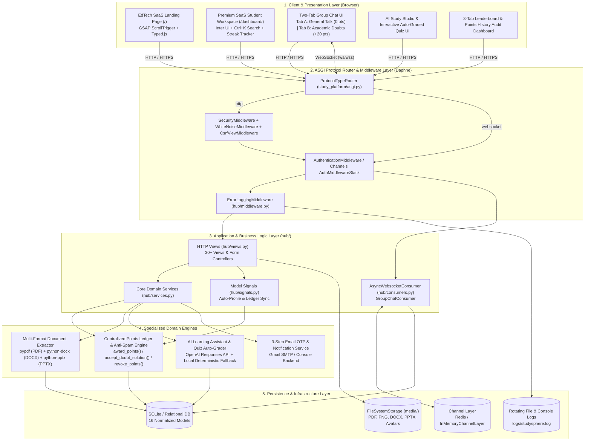
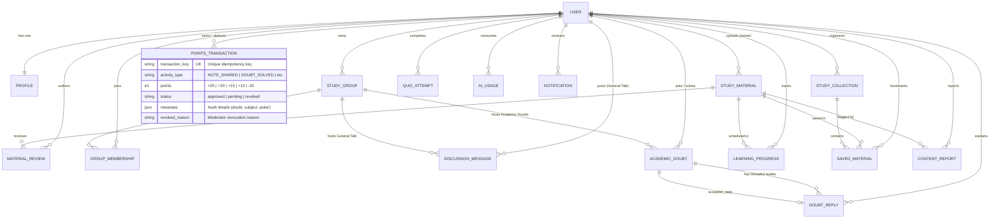
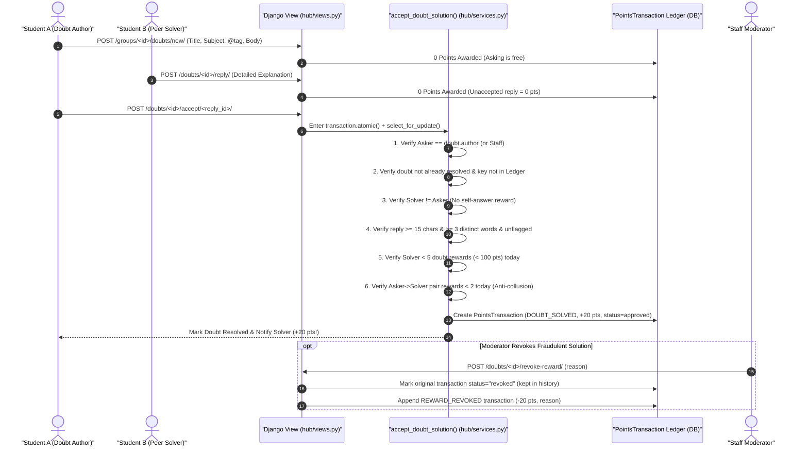

# StudySphere — System Architecture & Technical Design

**StudySphere** is a full-stack, real-time collaborative EdTech SaaS platform built on **Django 5.2**, **Django Channels (ASGI / Daphne)**, **SQLite / Redis**, and a dual-mode **AI Study Studio** (OpenAI + privacy-preserving local processor).

---

## 1. High-Level Layered System Architecture

StudySphere uses a **dual-protocol ASGI architecture** (`study_platform/asgi.py`) that routes standard HTTP requests through the Django WSGI/ASGI view layer and persistent full-duplex WebSocket connections (`/ws/groups/<id>/`) through `AuthMiddlewareStack` and `GroupChatConsumer`.

---

## 2. Database Entity-Relationship Architecture (16 Models)

All domain entities reside in `hub/models.py` and are migrated through `hub.0006_discussionmessage_is_system_and_more`.

---

## 3. Academic Doubt Reward (+20 pts) & Anti-Spam Ledger Flow

To prevent chat-spam score inflation, **General Talk** (`DiscussionMessage`) awards **0 points**, while **Academic Doubts** (`AcademicDoubt` + `DoubtReply`) award **+20 points** strictly when a valid solution is accepted through `accept_doubt_solution()` in `hub/services.py`.

---

## 4. Centralized Points & Ranking Architecture

Every point change in StudySphere flows through the centralized `PointsTransaction` ledger via `hub/services.py` and `hub/signals.py`:

| Activity Type | Trigger / Signal | Points | Idempotency Key Format |
| :--- | :--- | :---: | :--- |
| **`NOTE_SHARED`** | `StudyMaterial` saved (`is_published=True, is_flagged=False`) | **`+25`** | `NOTE_SHARED:StudyMaterial:<id>` |
| **`DOUBT_SOLVED`** | `accept_doubt_solution()` verified acceptance | **`+20`** | `DOUBT_SOLVED:AcademicDoubt:<id>` |
| **`RESOURCE_REVIEW`** | `MaterialReview` created | **`+15`** | `RESOURCE_REVIEW:MaterialReview:<id>` |
| **`MATERIAL_COMPLETED`** | `LearningProgress.completed = True` | **`+10`** | `MATERIAL_COMPLETED:LearningProgress:<id>` |
| **`QUIZ_COMPLETED`** | `QuizAttempt` created in AI Studio | **`+10`** | `QUIZ_COMPLETED:QuizAttempt:<id>` |
| **`REWARD_REVOKED`** | Staff moderation hide or reward revocation | **`-10` to `-25`** | `REWARD_REVOKED:PointsTransaction:<orig_id>` |
| **`ADMIN_ADJUSTMENT`** | Staff manual point adjustment with reason | **`±N`** | `ADMIN_ADJUSTMENT:<user_id>:<uuid>` |

---

## 5. AI Study Studio & Multi-Format Document Extraction Pipeline

```mermaid
flowchart LR
    UP["User Uploads File\n(PDF, PNG, DOCX, PPTX, TXT, MD)"] --> VAL["MaterialForm Validation\n(<= 15 MB, allowed extensions)"]
    VAL --> EXT["extract_text_from_upload()\n(pypdf / python-docx / python-pptx)"]
    EXT --> DBMAT[("StudyMaterial.extracted_text\n(up to 50,000 chars)")]
    DBMAT --> STUDIO["AI Study Studio (/ai-studio/)\nSelect Resource or Paste Text"]
    STUDIO --> LIMIT{"Daily Limit Check\n(< AI_DAILY_REQUEST_LIMIT)"}
    LIMIT -->|"Allowed"| KEY{"OPENAI_API_KEY\nConfigured?"}
    KEY -->|"Yes"| OAI["OpenAI Responses API\n(gpt-4.1-mini)"]
    KEY -->|"No / Error"| LOC["Local Privacy-Preserving\nStudy Processor"]
    OAI & LOC --> MODE{"Selected Mode"}
    MODE -->|"Summary / Questions / Explain"| OUT["Rendered Study Aid\n+ AIUsage Record"]
    MODE -->|"Practice Quiz (JSON)"| QUIZ["Interactive Radio-Button Quiz"]
    QUIZ --> GRADE["grade_quiz_view (/quiz-grade/)\nAuto-Grades & Saves QuizAttempt (+10 pts)"]
```

---

## 6. Security, Authentication & Observability Architecture

1. **Authentication & 3-Step Email OTP Recovery:**
   - Standard session authentication (`signup`, `login`, `logout`) paired with a 3-step Email OTP recovery flow (`/accounts/forgot-password/` → `/accounts/verify-otp/` → `/accounts/reset-password/`).
   - Generates a 6-digit OTP via `secrets.randbelow(900000) + 100000` with a 10-minute session TTL and a 5-attempt brute-force lock.
   - Automatic `.env` loader in `study_platform/settings.py` switches from console email output to live Gmail SMTP (`django.core.mail.backends.smtp.EmailBackend`) as soon as `EMAIL_HOST_USER` and `EMAIL_HOST_PASSWORD` are set.
2. **Access Control & Privacy Isolation:**
   - Group messages and doubts are gated by `GroupMembership` (with automatic enrollment for the default `Global Doubt & Study Lounge`).
   - `/points-history/` strictly scopes queries to `request.user` and returns `403 HttpResponseForbidden` if a student attempts to inspect or modify another student's ledger.
   - `/moderation/`, `/doubts/<id>/revoke-reward/`, `/transactions/<id>/revoke/`, and `/points/adjust/` enforce `request.user.is_staff`.
3. **Observability & Production Hardening:**
   - `ErrorLoggingMiddleware` logs unhandled exceptions with user context and stack traces to `logs/studysphere.log`.
   - `/health/` executes a live `SELECT 1` database check for container/load-balancer health probes.
   - Production mode (`DJANGO_DEBUG=false`) enables HSTS, secure cookies, SSL redirect, and WhiteNoise compressed manifest static storage.
