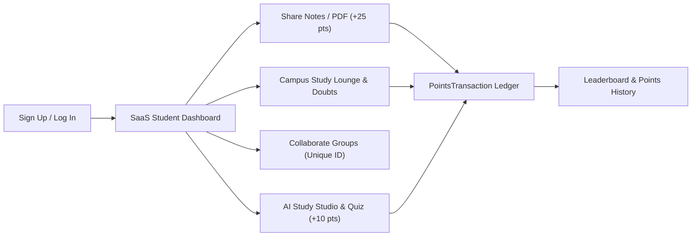

# 🎓 StudySphere — Collaborative EdTech SaaS & Academic Doubt Platform

[](https://www.python.org/)
[](https://www.djangoproject.com/)
[](https://channels.readthedocs.io/)
[](#testing--quality-assurance)

**StudySphere** is a full-stack collaborative learning platform built with **Django 5.2** and **Django Channels**. It combines multi-format study resource sharing (`PDF`, `PNG`, `DOCX`, `PPTX`, `MD`), a **WhatsApp / Instagram-style real-time Group Chat & Academic Doubt Forum**, a **Collaborate Study Group Workspace** with Unique Group IDs and Admin approval flows, an **AI Study Studio & Auto-Graded Quiz Engine**, spaced-repetition review scheduling, and an **Anti-Spam Campus Leaderboard** backed by a centralized `PointsTransaction` audit ledger.

---

## 📌 Table of Contents

1. [Core Features & How They Work](#-core-features--how-they-work)
2. [End-to-End Platform Workflows](#-end-to-end-platform-workflows)
3. [Leaderboard Point Structure & Anti-Spam Engine](#-leaderboard-point-structure--anti-spam-engine)
4. [Tech Stack & System Architecture](#-tech-stack--system-architecture)
5. [Project Directory Structure](#-project-directory-structure)
6. [Quick Start & Local Installation](#-quick-start--local-installation)
7. [Environment Variables (`.env`)](#-environment-variables-env)
8. [Testing & Quality Assurance](#-testing--quality-assurance)

---

## ✨ Core Features & How They Work

### 1. 💬 WhatsApp / Instagram-Style Real-Time Group Chat & Academic Doubts
Available in both the **Campus Study Lounge (`/global-chat/`)** and every private **Collaborate Study Group (`/groups/<pk>/`)**:
- **Right & Left Chat Bubble Layout:**
  - **Your Messages (Right Side):** Displayed inside a violet-indigo gradient bubble with white text, bottom-right chat tail, timestamp, delivered checkmarks (`✓✓`), **Reply**, and **Delete** buttons.
  - **Classmates' Messages (Left Side):** Displayed on the left with a circular initial avatar, crisp white bubble with bottom-left tail, `@username`, timestamp, and **Reply** action.
  - **Group Admin Badge (`👑 Admin`):** Whenever the Group Admin sends a message or replies to a doubt, a `👑 Admin` badge is automatically shown beside their `@username`.
  - **Instant Message Deletion:** Users can delete their own messages (`POST /messages/<id>/delete/`) smoothly in place via AJAX without reloading the page.
- **Two Dedicated Chat Tabs:**
  - **Tab A — General Talk (`0 pts`):** Casual real-time WebSocket and HTTP conversations. Awards `0` points so students cannot spam casual chat to climb the leaderboard.
  - **Tab B — Academic Doubts (`+20 pts / Accepted Solution`):** Uses the same sleek single-bar chat composer (`Enter` to send, `Shift+Enter` for newline). Students ask academic doubts or click **Reply** on any doubt bubble to post an explanation. The doubt author can click **`✓ Accept (+20 pts)`** right inside a reply bubble to mark the doubt solved and award `+20` Leaderboard points to the solver.

---

### 2. 🤝 Collaborate Workspace & Private Study Groups (`/groups/`)
A dedicated team collaboration system where students create or join focused study groups:
- **Create a Group with a Unique Group ID (`SS-XXXXXX`):**
  - Enter a **Group Name** and **Group Info** to create a study group.
  - StudySphere automatically generates a unique Group ID (e.g., `SS-7F3K9A`), assigns the creator as **`👑 Admin`**, and redirects directly into the group's chat workspace where the ID can be copied with one click.
- **Single Active Group Focus:**
  - While a student belongs to a custom study group, clicking **Collaborate** takes them directly to their active group chat room (hiding the Create/Join screen until they leave or delete their current group).
- **Two Ways to Add Members:**
  1. **Invite by `@username`:** Inside **`⚙️ Settings`**, enter any student's `@username` (`POST /groups/<pk>/invite/`) to send an invitation straight to their account. Invited students can click **`✓ Join`** on their Collaborate page to enter immediately.
  2. **Join by Unique Group ID (with Admin Approval):** A student enters the group's Unique ID (`SS-XXXXXX`) in the **Join Group** card (`POST /groups/join-by-id/`). The request appears in the Group Admin's **`⚙️ Settings → Join Requests`** queue with **`✓ Accept`** and **`✕ Decline`** buttons.
- **Group Settings, Transfer Admin, Leave & Delete Group:**
  - **Regular Members:** Can click **`Leave Group`** anytime to exit the group and return to the Create/Join screen.
  - **Group Admin:** To leave or join another group, the Admin must first either **Transfer Admin** to another member (or click **`Transfer & Leave`**) or click **`🗑️ Delete Group`**.

---

### 3. 🔔 Top Navbar Notification ON/OFF Toggle & Smart Email Alerts
- **One-Click Navbar Switch:** Right next to the study streak counter (`🔥`) in the top navigation bar, the notification bell is paired with a live **ON / OFF toggle switch** (`POST /notifications/toggle/`).
- **Instant Mute / Unmute:** Clicking the switch toggles email notifications via AJAX without reloading the page and updates the bell icon between active and muted (slashed bell).
- **Smart Email Filtering:**
  - Random **General Talk** chat messages **never** send email notifications.
  - When a student uploads or shares a **PDF or Study Notes**, email notifications are sent **only** to users whose notification switch is turned **ON**.

---

### 4. 📚 Multi-Format Resource Library & Spaced Repetition (`/materials/`)
- **Multi-Format Upload & Inline Preview:** Share `PDF`, `PNG`/`JPG`/`WebP` (with inline image preview), `DOCX`, `PPTX`, `TXT`, `MD`, or external links up to 15 MB (`+25 pts` per approved upload).
- **Peer Reviews & Moderation:** Rate resources 1–5 stars with written feedback (`+15 pts` per valid review) or flag inappropriate content for staff moderation (`/moderation/`).
- **Spaced-Repetition Scheduler:** Marking a resource complete (`+10 pts`) automatically schedules spaced review intervals (`1 → 2 → 4 → 8 → … → 60 days`).
- **Saved Collections (`/saved/`):** Bookmark resources and organize them into custom study collections.

---

### 5. 🤖 AI Study Studio & Auto-Graded Quizzes (`/ai-studio/`)
- **Automatic Document Text Extraction:** Extracts text from uploaded `PDF` (`pypdf`), `DOCX` (`python-docx`), `PPTX` (`python-pptx`), `TXT`, and `MD` files.
- **4 Study Modes:**
  1. **Concise Summary**
  2. **5 Important Short-Answer Questions**
  3. **Simple Analogy & Worked Explanation**
  4. **Interactive 5-Question Multiple-Choice Quiz** with instant auto-grading (`/quiz-grade/`), per-question explanations, and **`+10 pts`** reward upon completion.
- **Hybrid AI Engine:** Works offline out of the box with a deterministic local processor and automatically upgrades to OpenAI (`gpt-4.1-mini`) when `OPENAI_API_KEY` is set.

---

### 6. 🔐 Classy SaaS Authentication & Email OTP Password Reset
- **Clean, Distraction-Free Login & Sign-Up (`/accounts/login/`, `/signup/`):**
  - Frosted-glass SaaS card with floating ambient lavender orbs, top gradient accent bar, and 3D graduation-cap emblem.
  - All default password/username instruction clutter is hidden by default. Password rules (**at least 6 characters** and **at least one special character** like `@`, `#`, `$`, `!`, `_`, `-`) are displayed **only** inside an animated error alert banner if the user submits an invalid password.
- **3-Step Email OTP Forgot-Password Flow:**
  - `/accounts/forgot-password/` → sends a 6-digit OTP (10-minute expiry, 5-attempt cap) via Gmail SMTP → `/accounts/verify-otp/` → `/accounts/reset-password/`.

---

## 🔄 End-to-End Platform Workflows



---

## 🏆 Leaderboard Point Structure & Anti-Spam Engine

Every point award or deduction is recorded in the centralized **`PointsTransaction`** ledger with an idempotent `transaction_key`:

| Activity | Ledger Type | Points | Condition |
| :--- | :--- | :---: | :--- |
| **Share Approved Study Notes** | `NOTE_SHARED` | **`+25`** | Published and unflagged resource (`PDF`, `PNG`, `DOCX`, `PPTX`, `MD`, link) |
| **Solve Accepted Academic Doubt** | `DOUBT_SOLVED` | **`+20`** | Peer explanation accepted as the verified solution |
| **Write Valid Resource Review** | `RESOURCE_REVIEW` | **`+15`** | Valid 1–5 star rating and review on a peer's resource |
| **Complete Study Material** | `MATERIAL_COMPLETED` | **`+10`** | Marked complete in learning progress |
| **Complete AI Quiz** | `QUIZ_COMPLETED` | **`+10`** | Completed auto-graded quiz attempt in AI Studio |
| **General Talk Chat Message** | — | **`0`** | Casual chat messages never award points |

### Backend-Enforced Anti-Spam & Anti-Abuse Rules (`hub/services.py`)
1. **One Reward per Doubt:** Only one accepted answer can earn `+20 pts` per `AcademicDoubt` (enforced via `transaction.atomic()` + `select_for_update()` + unique `transaction_key`).
2. **No Self-Answer Rewards:** Students cannot accept their own reply for points (`reply.author_id != doubt.author_id`).
3. **Zero Points for Asking or Unaccepted Replies:** Points are only awarded when a solution is accepted.
4. **Minimum Explanation Quality:** Accepted solutions must be at least **15 characters** and **3 distinct words** (and unflagged).
5. **Daily Cap:** Maximum **5 rewarded solutions (100 doubt-solving points)** per student per day.
6. **Anti-Collusion Pair Limit:** Maximum **2 rewarded solutions per day** between the same `(asker, solver)` pair.
7. **Immutable Audit Trail & Moderator Revocation:** Staff can revoke fraudulent rewards (`/doubts/<id>/revoke-reward/` or `/transactions/<id>/revoke/`), which marks the original entry `revoked` and records a `-20` `REWARD_REVOKED` reversal entry without deleting history.

---

## 🛠 Tech Stack & System Architecture

| Layer | Technology |
| :--- | :--- |
| **Backend Framework** | Python 3.12+, Django 5.2 |
| **Real-Time WebSockets** | Django Channels (`AsyncWebsocketConsumer`), Daphne ASGI, Redis / In-Memory Channel Layer |
| **Database** | SQLite3 (Development) / PostgreSQL-ready (17 normalized models, atomic ledger constraints) |
| **Frontend & Animations** | Semantic HTML5, Custom CSS3 Design System (`static/css/app.css`), Vanilla ES6 JS, GSAP ScrollTrigger, Typed.js |
| **Document Processing** | `pypdf` (PDF), `python-docx` (DOCX), `python-pptx` (PPTX), `Pillow` (Avatars & PNG/Image Notes) |
| **Static & Media Serving** | WhiteNoise + Django `FileSystemStorage` |

*(For detailed system, database ER, and sequence diagrams, see [ARCHITECTURE.md](ARCHITECTURE.md).)*

---

## 📂 Project Directory Structure

```text
StudySphere/
├── manage.py
├── requirements.txt
├── Dockerfile
├── .env.example
├── ARCHITECTURE.md
├── PROJECT_STATUS.md
├── README.md
├── study_platform/          # Project configuration (settings.py, urls.py, asgi.py, wsgi.py)
├── hub/                     # Core application (models, services, signals, views, forms, consumers, tests)
├── templates/               # HTML templates (base.html, hub/*, registration/*)
└── static/css/app.css       # Unified SaaS, Auth, Collaborate & WhatsApp/Instagram Chat stylesheet
```

---

## 🚀 Quick Start & Local Installation

### 1. Clone the Repository & Create Virtual Environment
```powershell
git clone https://github.com/5556Prabhat/StudySphere.git
cd StudySphere
python -m venv .venv
```

### 2. Install Dependencies
```powershell
.\.venv\Scripts\pip.exe install -r requirements.txt
```

### 3. Apply Database Migrations & Collect Static Files
```powershell
.\.venv\Scripts\python.exe manage.py migrate
.\.venv\Scripts\python.exe manage.py collectstatic --noinput
```

### 4. Start the Development Server
```powershell
.\.venv\Scripts\python.exe manage.py runserver
```

Open **http://127.0.0.1:8000/** in your browser:
- **EdTech Landing Page:** `http://127.0.0.1:8000/`
- **Student Dashboard:** `http://127.0.0.1:8000/dashboard/`
- **Campus Study Lounge (General Talk & Academic Doubts):** `http://127.0.0.1:8000/global-chat/`
- **Collaborate Study Groups (Create / Join by Unique ID):** `http://127.0.0.1:8000/groups/`
- **Leaderboard & How to Earn Points:** `http://127.0.0.1:8000/leaderboard/`
- **Personal Points History Ledger:** `http://127.0.0.1:8000/points-history/`
- **AI Study Studio:** `http://127.0.0.1:8000/ai-studio/`
- **System Health Check:** `http://127.0.0.1:8000/health/`

*(Optional: Run `.\.venv\Scripts\python.exe manage.py seed_demo` to populate sample accounts and study materials.)*

---

## ⚙️ Environment Variables (`.env`)

Copy `.env.example` to `.env` in the project root. StudySphere automatically loads `.env` at startup:

```ini
DJANGO_SECRET_KEY=replace-with-a-long-random-secret-key
DJANGO_DEBUG=true
DJANGO_ALLOWED_HOSTS=localhost,127.0.0.1

# Optional: Gmail SMTP for Email OTP Password Reset & Shared Notes Email Alerts
EMAIL_HOST=smtp.gmail.com
EMAIL_PORT=587
EMAIL_USE_TLS=true
EMAIL_HOST_USER=your-email@gmail.com
EMAIL_HOST_PASSWORD=your-16-char-google-app-password

# Optional: OpenAI API Key (falls back to built-in local AI processor when blank)
OPENAI_API_KEY=
OPENAI_MODEL=gpt-4.1-mini
```

---

## 🧪 Testing & Quality Assurance

StudySphere includes **37 automated unit and integration tests** in [hub/tests.py](hub/tests.py) covering:
- Resource sharing (`PDF`, `PNG`, `DOCX`, `PPTX` extraction), reviews, and spaced-repetition scheduling.
- AI Study Studio generation and quiz auto-grading.
- Academic Doubt `+20 pts` solution acceptance, anti-spam rules, daily reward limits, and moderator reward revocation.
- Centralized `PointsTransaction` ledger integrity and Points History privacy/filtering.
- Per-message deletion in General Talk and top-navbar Notification ON/OFF email filtering.
- Collaborate group creation with Unique Group IDs (`SS-XXXXXX`), `@username` invitations, Group ID join requests with Admin approval, Admin transfer, Leave Group, and Delete Group.

Run the full test suite with:

```powershell
.\.venv\Scripts\python.exe manage.py test hub -v2
```
